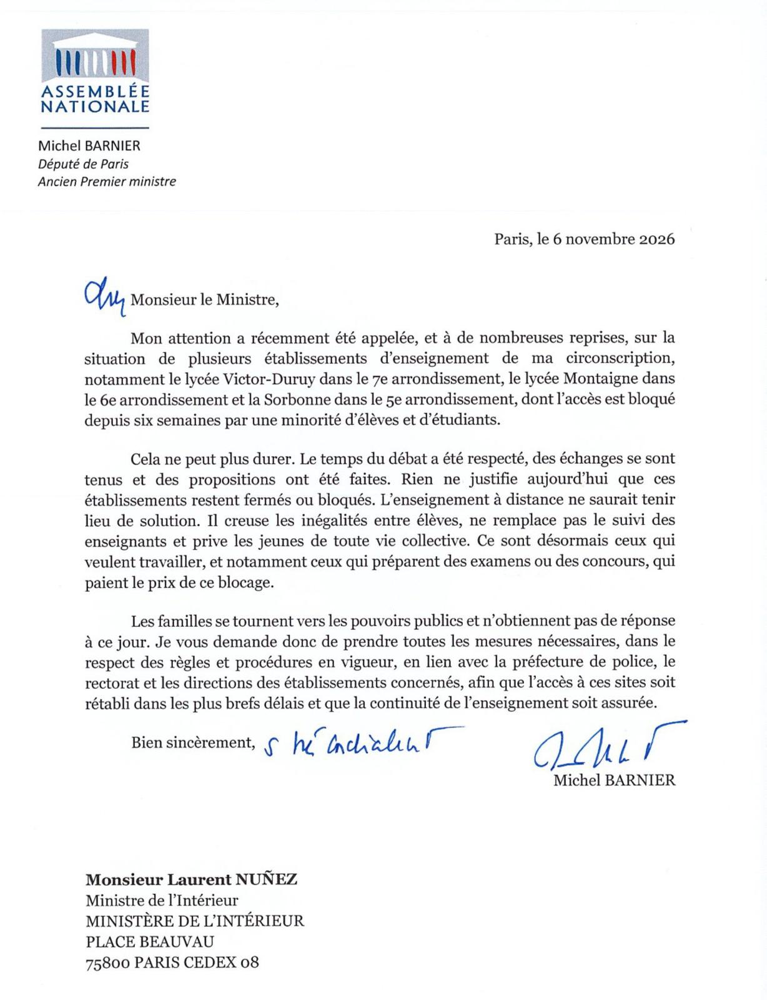

[← Retour aux ressources](./)

# Lettre de Michel Barnier au ministre de l'Intérieur

## De quoi s'agit-il ?

Lettre datée du **6 novembre 2026**, adressée par **Michel Barnier, député de Paris et ancien Premier ministre**, à **Laurent Nuñez, ministre de l'Intérieur**.

Elle porte sur les **blocages d'établissements de sa circonscription** : le lycée Victor-Duruy (7e), le lycée Montaigne (6e) et la Sorbonne (5e), dont l'accès est bloqué depuis six semaines par une minorité d'élèves et d'étudiants. Le député y fait le constat suivant :

- le temps du débat a été respecté, des échanges ont eu lieu et des propositions ont été faites : plus rien ne justifie que ces établissements restent fermés ou bloqués ;
- l'**enseignement à distance n'est pas une solution** : il creuse les inégalités entre élèves, ne remplace pas le suivi des enseignants et prive les jeunes de vie collective ;
- ce sont **ceux qui veulent travailler**, notamment ceux qui préparent des examens ou des concours, qui paient le prix du blocage ;
- les familles se tournent vers les pouvoirs publics et n'obtiennent pas de réponse.

Il demande au ministre de **prendre toutes les mesures nécessaires, dans le respect des règles et procédures en vigueur**, en lien avec la préfecture de police, le rectorat et les directions d'établissement, pour **rétablir l'accès aux sites dans les plus brefs délais** et assurer la continuité de l'enseignement.

## Texte intégral

> Michel BARNIER  
> *Député de Paris*  
> *Ancien Premier ministre*
>
> Paris, le 6 novembre 2026

*[mention manuscrite]* Monsieur le Ministre,

Mon attention a récemment été appelée, et à de nombreuses reprises, sur la situation de plusieurs établissements d'enseignement de ma circonscription, notamment le lycée Victor-Duruy dans le 7e arrondissement, le lycée Montaigne dans le 6e arrondissement et la Sorbonne dans le 5e arrondissement, dont l'accès est bloqué depuis six semaines par une minorité d'élèves et d'étudiants.

Cela ne peut plus durer. Le temps du débat a été respecté, des échanges se sont tenus et des propositions ont été faites. Rien ne justifie aujourd'hui que ces établissements restent fermés ou bloqués. L'enseignement à distance ne saurait tenir lieu de solution. Il creuse les inégalités entre élèves, ne remplace pas le suivi des enseignants et prive les jeunes de toute vie collective. Ce sont désormais ceux qui veulent travailler, et notamment ceux qui préparent des examens ou des concours, qui paient le prix de ce blocage.

Les familles se tournent vers les pouvoirs publics et n'obtiennent pas de réponse à ce jour. Je vous demande donc de prendre toutes les mesures nécessaires, dans le respect des règles et procédures en vigueur, en lien avec la préfecture de police, le rectorat et les directions des établissements concernés, afin que l'accès à ces sites soit rétabli dans les plus brefs délais et que la continuité de l'enseignement soit assurée.

Bien sincèrement, *[mention manuscrite]*

Michel BARNIER

> **Monsieur Laurent NUÑEZ**  
> Ministre de l'Intérieur  
> Ministère de l'Intérieur  
> Place Beauvau  
> 75800 PARIS CEDEX 08

## Document original

