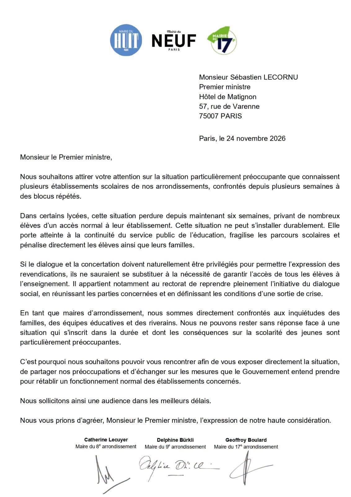

[← Retour aux ressources](./)

# Lettre de trois maires d'arrondissement au Premier ministre

## De quoi s'agit-il ?

Cette lettre, datée du **24 novembre 2026**, est adressée au **Premier ministre, Sébastien Lecornu**. Elle est signée par les maires de **trois arrondissements parisiens** : le 8e, le 9e et le 17e.

Elle porte sur les **blocus répétés** que connaissent plusieurs lycées de leurs arrondissements. Les signataires font le constat suivant :

- dans certains lycées, la situation dure depuis **six semaines** et prive de nombreux élèves d'un accès normal à leur établissement ;
- elle porte atteinte à la **continuité du service public de l'éducation**, fragilise les parcours scolaires et pénalise les élèves et leurs familles ;
- le dialogue doit être privilégié, mais il **ne peut se substituer à la nécessité de garantir l'accès de tous les élèves à l'enseignement**.

Ils demandent que le **rectorat reprenne l'initiative du dialogue** en réunissant les parties concernées pour définir une sortie de crise. Ils sollicitent aussi une **audience auprès du Premier ministre** dans les meilleurs délais, pour connaître les mesures que le Gouvernement entend prendre.

Deux semaines plus tôt, ces trois maires avaient déjà écrit à la rectrice avec cinq de leurs collègues (voir la [lettre de huit maires du 10 novembre](lettre-maires-rectrice-2026-11-10.html)).

## Texte intégral

> Monsieur Sébastien LECORNU  
> Premier ministre  
> Hôtel de Matignon  
> 57, rue de Varenne  
> 75007 PARIS
>
> Paris, le 24 novembre 2026

Monsieur le Premier ministre,

Nous souhaitons attirer votre attention sur la situation particulièrement préoccupante que connaissent plusieurs établissements scolaires de nos arrondissements, confrontés depuis plusieurs semaines à des blocus répétés.

Dans certains lycées, cette situation perdure depuis maintenant six semaines, privant de nombreux élèves d'un accès normal à leur établissement. Cette situation ne peut s'installer durablement. Elle porte atteinte à la continuité du service public de l'éducation, fragilise les parcours scolaires et pénalise directement les élèves ainsi que leurs familles.

Si le dialogue et la concertation doivent naturellement être privilégiés pour permettre l'expression des revendications, ils ne sauraient se substituer à la nécessité de garantir l'accès de tous les élèves à l'enseignement. Il appartient notamment au rectorat de reprendre pleinement l'initiative du dialogue social, en réunissant les parties concernées et en définissant les conditions d'une sortie de crise.

En tant que maires d'arrondissement, nous sommes directement confrontés aux inquiétudes des familles, des équipes éducatives et des riverains. Nous ne pouvons rester sans réponse face à une situation qui s'inscrit dans la durée et dont les conséquences sur la scolarité des jeunes sont particulièrement préoccupantes.

C'est pourquoi nous souhaitons pouvoir vous rencontrer afin de vous exposer directement la situation, de partager nos préoccupations et d'échanger sur les mesures que le Gouvernement entend prendre pour rétablir un fonctionnement normal des établissements concernés.

Nous sollicitons ainsi une audience dans les meilleurs délais.

Nous vous prions d'agréer, Monsieur le Premier ministre, l'expression de notre haute considération.

| Signataire | Mandat |
|---|---|
| Catherine Lecuyer | Maire du 8e arrondissement |
| Delphine Bürkli | Maire du 9e arrondissement |
| Geoffroy Boulard | Maire du 17e arrondissement |

## Document original

