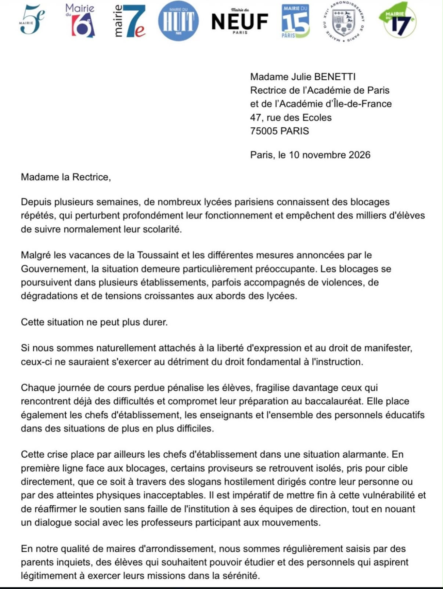
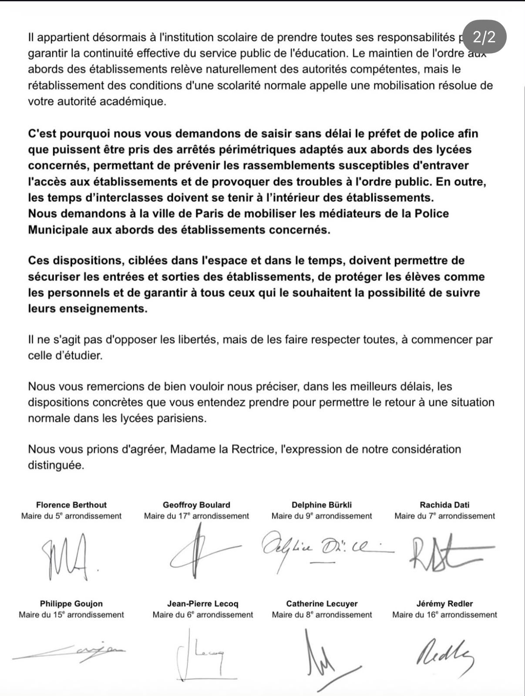

[← Retour aux ressources](./)

# Lettre de huit maires d'arrondissement à la rectrice de Paris

## De quoi s'agit-il ?

Lettre datée du **10 novembre 2026**, adressée à **Julie Benetti, rectrice de l'académie de Paris et de l'académie d'Île-de-France**, par les maires de **huit arrondissements parisiens** : 5e, 6e, 7e, 8e, 9e, 15e, 16e et 17e.

Elle porte sur les **blocages répétés de lycées parisiens** depuis plusieurs semaines. Les signataires y font le constat suivant :

- les blocages se poursuivent malgré les vacances de la Toussaint et les mesures annoncées par le Gouvernement, parfois avec des violences, des dégradations et des tensions aux abords des lycées ;
- chaque journée de cours perdue pénalise les élèves, surtout les plus fragiles, et compromet la préparation du baccalauréat ;
- certains proviseurs sont isolés et pris pour cible, par des slogans ou des atteintes physiques.

Ils formulent trois demandes concrètes :

1. que la rectrice **saisisse sans délai le préfet de police** pour que soient pris des **arrêtés périmétriques** aux abords des lycées concernés, afin de prévenir les rassemblements qui entravent l'accès aux établissements ;
2. que les **interclasses se tiennent à l'intérieur** des établissements ;
3. que la **Ville de Paris mobilise les médiateurs de la Police municipale** aux abords des lycées concernés.

Ils demandent enfin à la rectrice de préciser, dans les meilleurs délais, les dispositions concrètes qu'elle entend prendre.

## Texte intégral

> Madame Julie BENETTI  
> Rectrice de l’Académie de Paris  
> et de l’Académie d’Île-de-France  
> 47, rue des Écoles  
> 75005 PARIS
>
> Paris, le 10 novembre 2026

Madame la Rectrice,

Depuis plusieurs semaines, de nombreux lycées parisiens connaissent des blocages répétés, qui perturbent profondément leur fonctionnement et empêchent des milliers d'élèves de suivre normalement leur scolarité.

Malgré les vacances de la Toussaint et les différentes mesures annoncées par le Gouvernement, la situation demeure particulièrement préoccupante. Les blocages se poursuivent dans plusieurs établissements, parfois accompagnés de violences, de dégradations et de tensions croissantes aux abords des lycées.

Cette situation ne peut plus durer.

Si nous sommes naturellement attachés à la liberté d'expression et au droit de manifester, ceux-ci ne sauraient s'exercer au détriment du droit fondamental à l'instruction.

Chaque journée de cours perdue pénalise les élèves, fragilise davantage ceux qui rencontrent déjà des difficultés et compromet leur préparation au baccalauréat. Elle place également les chefs d'établissement, les enseignants et l'ensemble des personnels éducatifs dans des situations de plus en plus difficiles.

Cette crise place par ailleurs les chefs d'établissement dans une situation alarmante. En première ligne face aux blocages, certains proviseurs se retrouvent isolés, pris pour cible directement, que ce soit à travers des slogans hostilement dirigés contre leur personne ou par des atteintes physiques inacceptables. Il est impératif de mettre fin à cette vulnérabilité et de réaffirmer le soutien sans faille de l'institution à ses équipes de direction, tout en nouant un dialogue social avec les professeurs participant aux mouvements.

En notre qualité de maires d'arrondissement, nous sommes régulièrement saisis par des parents inquiets, des élèves qui souhaitent pouvoir étudier et des personnels qui aspirent légitimement à exercer leurs missions dans la sérénité.

Il appartient désormais à l'institution scolaire de prendre toutes ses responsabilités pour garantir la continuité effective du service public de l'éducation. Le maintien de l'ordre aux abords des établissements relève naturellement des autorités compétentes, mais le rétablissement des conditions d'une scolarité normale appelle une mobilisation résolue de votre autorité académique.

**C'est pourquoi nous vous demandons de saisir sans délai le préfet de police afin que puissent être pris des arrêtés périmétriques adaptés aux abords des lycées concernés, permettant de prévenir les rassemblements susceptibles d'entraver l'accès aux établissements et de provoquer des troubles à l'ordre public. En outre, les temps d’interclasses doivent se tenir à l’intérieur des établissements.  
Nous demandons à la ville de Paris de mobiliser les médiateurs de la Police Municipale aux abords des établissements concernés.**

**Ces dispositions, ciblées dans l'espace et dans le temps, doivent permettre de sécuriser les entrées et sorties des établissements, de protéger les élèves comme les personnels et de garantir à tous ceux qui le souhaitent la possibilité de suivre leurs enseignements.**

Il ne s'agit pas d'opposer les libertés, mais de les faire respecter toutes, à commencer par celle d’étudier.

Nous vous remercions de bien vouloir nous préciser, dans les meilleurs délais, les dispositions concrètes que vous entendez prendre pour permettre le retour à une situation normale dans les lycées parisiens.

Nous vous prions d'agréer, Madame la Rectrice, l'expression de notre considération distinguée.

| Signataire | Mandat |
|---|---|
| Florence Berthout | Maire du 5e arrondissement |
| Geoffroy Boulard | Maire du 17e arrondissement |
| Delphine Bürkli | Maire du 9e arrondissement |
| Rachida Dati | Maire du 7e arrondissement |
| Philippe Goujon | Maire du 15e arrondissement |
| Jean-Pierre Lecoq | Maire du 6e arrondissement |
| Catherine Lecuyer | Maire du 8e arrondissement |
| Jérémy Redler | Maire du 16e arrondissement |

## Document original

